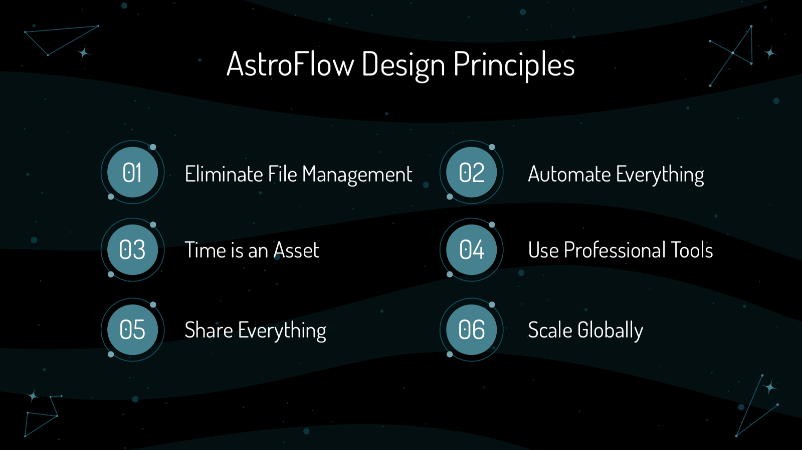
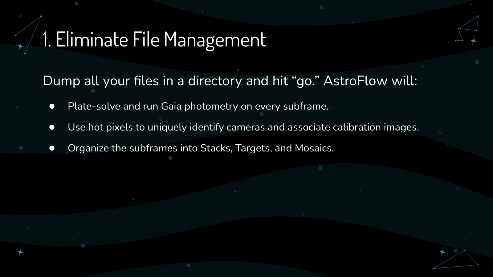
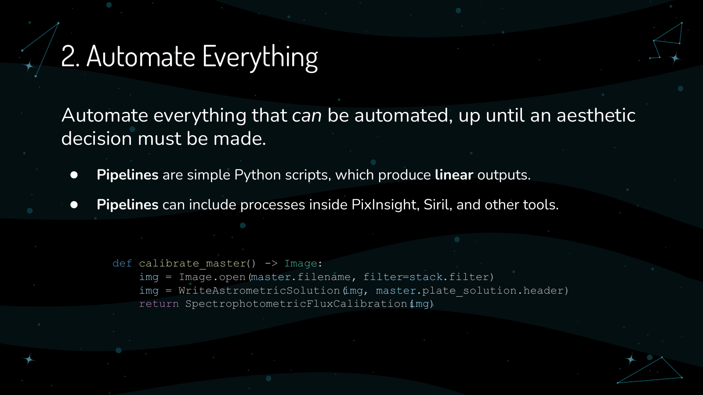
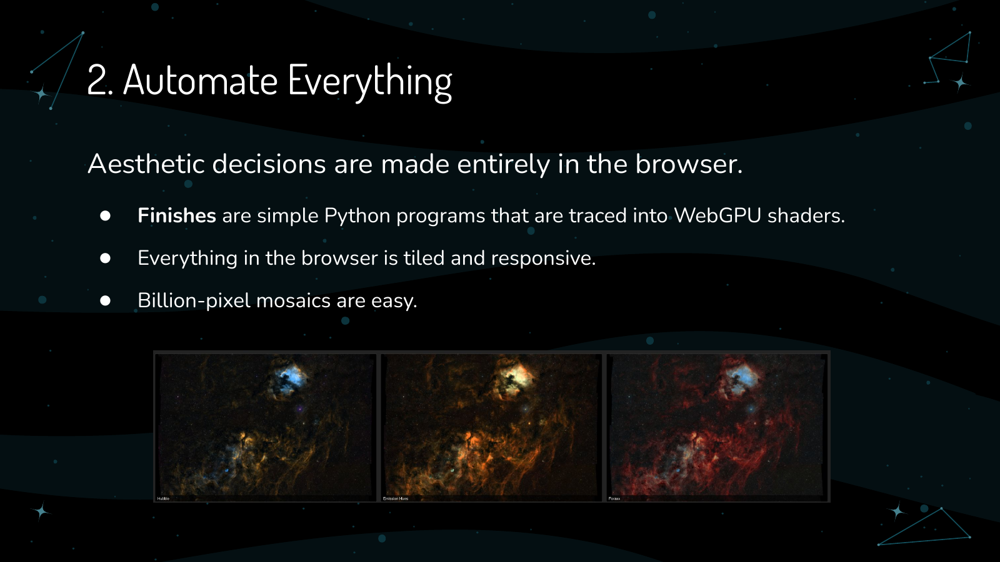
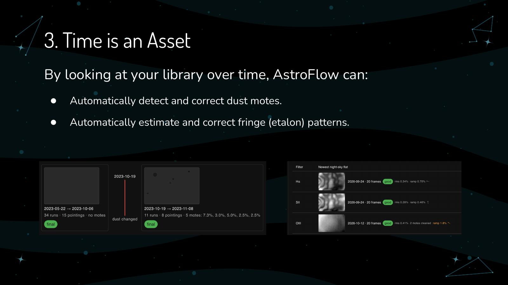
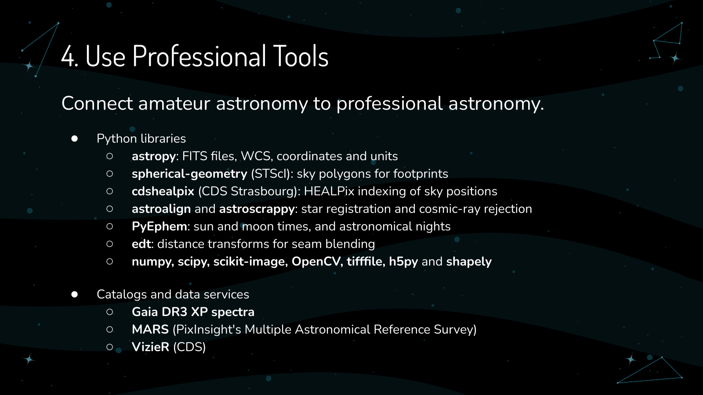
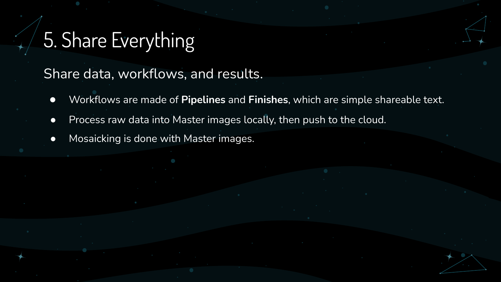
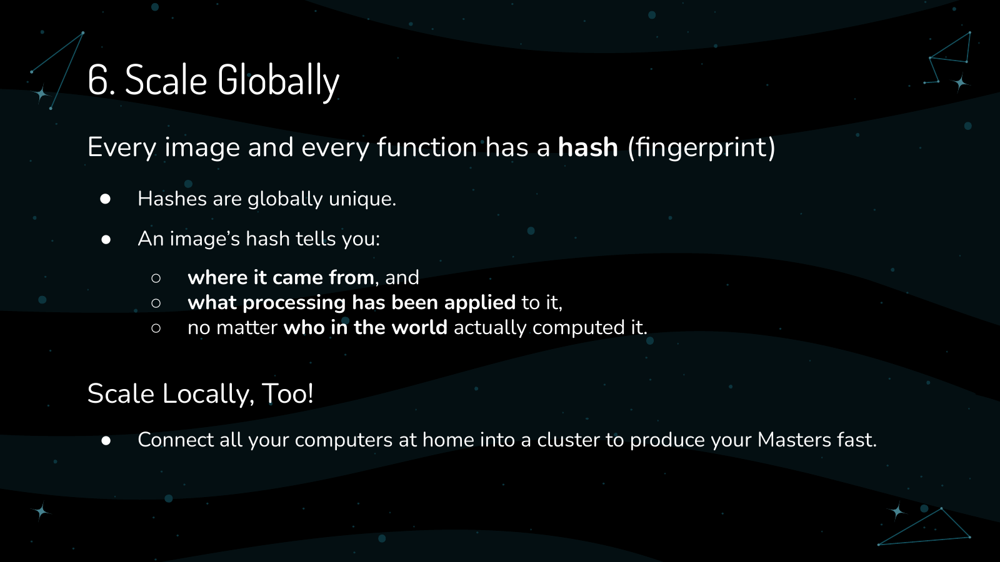

# AstroFlow

AstroFlow turns a night of raw frames into finished images while you sleep. Point it at the
folders your capture software writes to, and it calibrates, stacks, places and blends the
panels of each mosaic, applies the finishing steps, and shows the result in a browser, updated
after every batch. It also plans the next night: which panels want which filters, in what
order, given the moon, the weather and what the library already holds.

It runs on your own computer, as a local web app, and reaches for the best tool for each job
rather than reimplementing it: Siril for stacking, astrometry.net for plate solving, GraXpert
for background extraction, and, if you have them, PixInsight and the RC Astro tools. Every
product is addressed by the content it was made from, so nothing is computed twice and a
change upstream rebuilds exactly what depends on it.

The longer aim is a full-sky, amateur-driven survey at half an arcsecond per pixel, assembled
from thousands of telescopes. The pieces built for one person's library are the same pieces
that job needs: content-addressed products, provenance, cross-instrument calibration, and a
planner that knows where coverage is thin.

## Installing

Releases are on the [releases page](https://github.com/Stylistic7/AstroFlow/releases); each
one lists the checksums of its files in `SHA256SUMS`.

- **macOS**, Apple silicon: open the dmg and drag AstroFlow to Applications. The app is not yet
  signed, so the first launch stops at "Apple could not verify AstroFlow is free of malware",
  a dialog with no way through. Click Done, open System Settings > Privacy & Security and
  scroll to the Security section, where "AstroFlow was blocked" now has an Open Anyway button;
  click it, authenticate, and launch again. Once.
- **Windows 11**, x64: unzip, keep the `.exe` and the `-1.bin` slice together, run the exe.
  SmartScreen: More info > Run anyway.

The installers carry the plate solver, libvips and GraXpert. At its first start the app
fetches what those need beside the code, about 5.9 GB: the astrometry.net index files from
their publishers, and the Gaia XP catalogue the photometry uses from the project's data store,
each file checked against the sha256 in `core/refdata/manifest.txt`; GraXpert fetches its own
model. A machine that already keeps the index files or the catalogue elsewhere names them with
`ASTROFLOW_INDEX_DIR` and `ASTROFLOW_GAIA_CATALOG`, and fetches nothing. You install
[Siril](https://siril.org) 1.4 yourself, and optionally [PixInsight](https://pixinsight.com)
and the [RC Astro](https://www.rc-astro.com) tools; the app's Third-Party Tools page shows what
it found, what each one is for, and how much of the reference data is in place.

On first launch the app opens at `http://localhost:8000`. The Folders page is where you name
the folder your capture software writes to and the folder the products go to; the rest
happens on its own.

## Design principles

Six principles, in eight slides ([PDF](docs/AstroFlow-Design-Principles.pdf)):

The slides, one principle at a time

## Contributing

Pull requests are welcome; see [CONTRIBUTING.md](CONTRIBUTING.md) for the sign-off, the
test tiers and the code rules. Every pull request runs the unit tier and the frontend build
on GitHub's runners, with no fixtures or tools needed. The real-frame fixtures live in a
public [data store](https://github.com/Stylistic7/astroflow-testdata) and one command
fetches them for the full suite.

AstroFlow is licensed under the [Apache License 2.0](LICENSE).

## Acknowledgements

AstroFlow stands on [Siril](https://siril.org), [astrometry.net](https://astrometry.net),
[GraXpert](https://graxpert.com), [libvips](https://www.libvips.org), [Ray](https://ray.io),
and the [Gaia](https://www.cosmos.esa.int/gaia) mission's DR3 catalogue, processed by the
Gaia Data Processing and Analysis Consortium.
